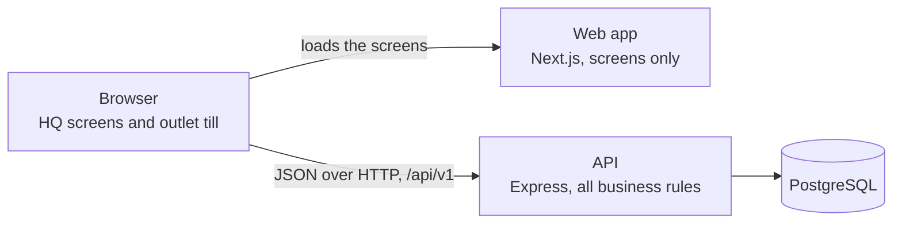
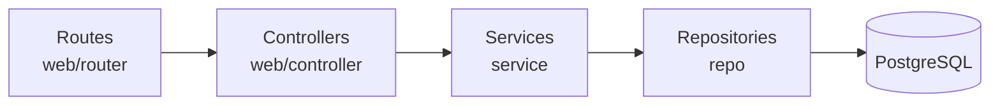
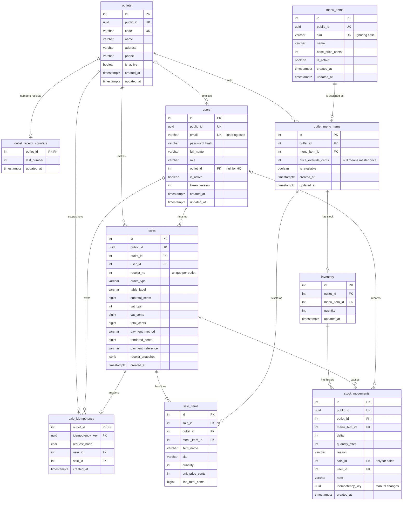
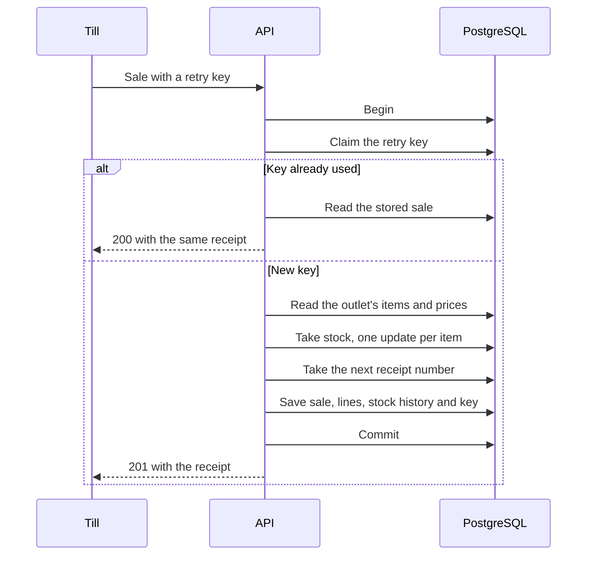
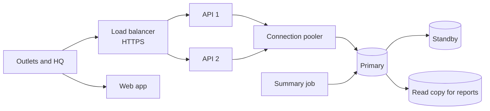
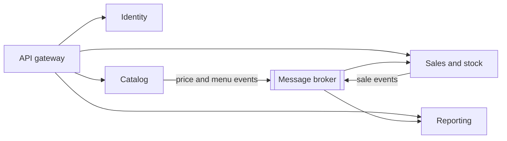
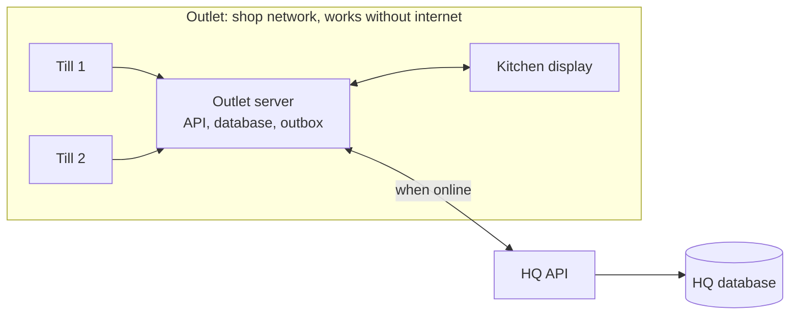
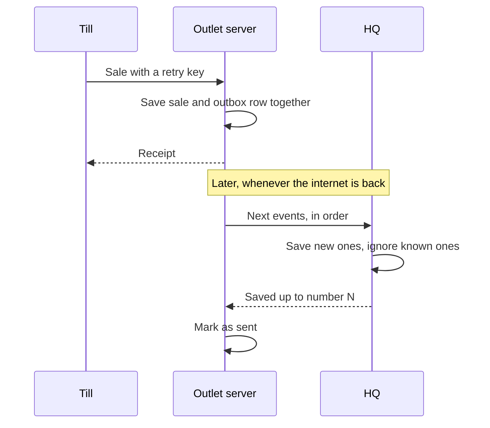

# Architecture

How the system is built today, and how it could grow. Setup and API endpoints are in the [README](../README.md).

Sections 1 to 5 describe **what is built**. Sections 6 to 8 are **plans**: nothing in them is implemented, and no
load has been measured.

## Contents

1. [Overview](#1-overview)
2. [Code layers](#2-code-layers)
3. [Database](#3-database)
4. [Sales, stock and receipt numbers](#4-sales-stock-and-receipt-numbers)
5. [Security](#5-security)
6. [Scaling plan](#6-scaling-plan)
7. [Moving to microservices](#7-moving-to-microservices)
8. [Offline POS and kitchen display](#8-offline-pos-and-kitchen-display)

## 1. Overview

One company, one API, one database. HQ and outlets use the same system, and each person's role decides what they can
reach.

Main choices:

| Choice                              | Why                                                                     |
| ----------------------------------- | ----------------------------------------------------------------------- |
| One application in layers           | A sale needs stock, receipt number and sale in one database transaction |
| Rules in the API and the database   | The screens can be wrong or old; the data cannot                        |
| SQL for joins and concurrent writes | The exact statement and its locks are visible. Simple tables use models |
| SQL migrations                      | Constraints and indexes are written out and versioned                   |
| Public UUIDs beside number ids      | Number ids keep joins small; clients cannot guess or count records      |
| Money as whole paisa                | No rounding errors from decimals                                        |

## 2. Code layers

| Layer        | Does                                                        | Never                   |
| ------------ | ----------------------------------------------------------- | ----------------------- |
| Routes       | Paths, login and role checks                                | Business logic          |
| Controllers  | Validate input with Joi, call one service, build the answer | Database calls          |
| Services     | Business rules and transactions                             | Use request or response |
| Repositories | Run queries                                                 | Decide business rules   |

-   **Validation:** strict Joi schemas. A field that is not listed is refused.
-   **Errors:** one error handler gives every failure the same shape. Database messages are never sent to a client,
    because they can contain stored values.
-   **Settings:** environment variables, checked when the API starts. A wrong one stops the start.
-   **Output:** a mapper per record lists each field the client may see, so a new column is never shown by accident.

## 3. Database

### ERD

### Rules the database enforces

| Rule                                         | How                                                                       |
| -------------------------------------------- | ------------------------------------------------------------------------- |
| Stock is never negative                      | `CHECK` quantity between 0 and 1,000,000                                  |
| Stock exists only for assigned items         | Foreign key `inventory (outlet_id, menu_item_id)` to the assignment       |
| An outlet sells only its assigned items      | The same two-column foreign key from `sale_items`                         |
| A sale line belongs to a sale of that outlet | Foreign key `sale_items (sale_id, outlet_id)` to `sales`                  |
| No repeated receipt number in an outlet      | `UNIQUE (outlet_id, receipt_no)`                                          |
| Amounts add up                               | `CHECK` line total = quantity x price, and total = subtotal + VAT         |
| Cash covers the total                        | `CHECK` on `tendered_cents`, which only cash sales have                   |
| Stock history makes sense                    | `CHECK` the direction fits the reason; sale movements point to their sale |
| One assignment per outlet and item           | `UNIQUE (outlet_id, menu_item_id)`                                        |
| Staff have an outlet, HQ admins do not       | `CHECK` on role and `outlet_id`                                           |
| History is not lost                          | Every foreign key is `ON DELETE RESTRICT`                                 |

Two rules need more than one table and are kept by the services and covered by tests: a sale's subtotal equals the
sum of its lines, and the current stock equals the last `quantity_after`.

**Copies kept on purpose:** a sale line stores the item's name, SKU and price, and a sale stores the VAT rate and a
receipt snapshot (company, outlet, cashier). Renaming something or changing a price never changes an old receipt.

### Indexes

| Index                                                                     | Used for                             |
| ------------------------------------------------------------------------- | ------------------------------------ |
| Unique `public_id` on shown tables                                        | Every lookup by an id from a client  |
| Unique `outlets (code)`, `lower(menu_items.sku)`, `lower(users.email)`    | No duplicates; login by email        |
| `users (outlet_id)`                                                       | Staff of an outlet                   |
| Unique `outlet_menu_items (outlet_id, menu_item_id)`                      | One outlet's menu                    |
| `outlet_menu_items (menu_item_id)`                                        | Outlets that sell an item            |
| Unique `inventory (outlet_id, menu_item_id)`                              | Stock change at checkout             |
| `stock_movements (outlet_id, menu_item_id, id DESC)`                      | History of one item                  |
| Unique `stock_movements (outlet_id, idempotency_key)`, when a key is set  | Retried stock change                 |
| Unique `sales (outlet_id, receipt_no)`                                    | Search by receipt number             |
| `sales (outlet_id, created_at DESC, id DESC)` including the three amounts | Outlet history and revenue report    |
| `sales (outlet_id, user_id, created_at DESC, id DESC)`                    | A cashier's own sales                |
| `sales (created_at DESC, id DESC)`                                        | All outlets in one list; date ranges |
| Unique `sale_items (sale_id, menu_item_id)`                               | Receipt lines; top items report      |
| Primary key `sale_idempotency (outlet_id, idempotency_key)`               | Retried sale                         |

Name and SKU search has no index of its own: those tables are small. A trigram index would be the fix if they grew.

## 4. Sales, stock and receipt numbers

### One sale, one transaction

Any refusal or failure rolls the whole transaction back: stock, receipt number, sale and key.

### Correct under concurrent requests

| Risk                                  | Answer                                                                                                                                            |
| ------------------------------------- | ------------------------------------------------------------------------------------------------------------------------------------------------- |
| Two sales take the last item          | One `UPDATE` changes stock only when the result stays 0 or more. The second waits for the row lock, checks again and is refused                   |
| Two sales get the same receipt number | The number comes from `UPDATE outlet_receipt_counters ... RETURNING`. The row stays locked until commit                                           |
| A failed sale leaves a gap            | The counter change is rolled back with the sale. A database sequence would not give the number back                                               |
| Two sales wait for each other         | Locks are taken in one order: retry key, stock rows sorted by item, receipt counter last. A deadlock that still happens is retried, up to 3 tries |
| A request hangs on a lock             | Lock, query and idle-transaction time limits. The client gets `503` and can send again                                                            |

The default isolation level (read committed) is enough, because each check and its write happen in one statement or
under a row lock.

**The cost:** sales of one outlet finish one after another from the moment they take the counter until they commit.
The counter is taken last to keep that short. Different outlets do not wait for each other.

Tests check this on a real PostgreSQL: 50 buyers for the last 10 items give 10 sales numbered 1 to 10; two outlets
selling at once are numbered separately; baskets in opposite order do not deadlock.

### A lost answer does not charge twice

The dangerous case: the sale is saved, but the answer never reaches the till.

-   The till creates a retry key (UUID) and writes the sale and key to browser storage **before** sending.
-   While there is no answer, the cart is locked and the only action is to send the same request again.
-   The API claims the key first, in the same transaction. A second copy arriving at the same moment waits, then finds
    the finished sale.
-   A hash of the whole request is stored with the key. The same key with different content is refused, and so is the
    same key from another person.
-   A retry is answered even if the outlet or an item has been switched off since.

Manual stock changes use the same idea: the stock row is locked, an earlier change with the same key is looked up,
and the change is applied only once.

### Prices

The client never sends a price. It sends the total the customer was shown; if the server's total differs (a price or
VAT change), nothing is saved and the till shows the new prices to confirm.

## 5. Security

| Area       | What is done                                                                                                                            |
| ---------- | --------------------------------------------------------------------------------------------------------------------------------------- |
| Passwords  | scrypt with a random salt                                                                                                               |
| Login      | Signed token (HS256, 8 hours). A wrong password, unknown email and switched-off user get one answer                                     |
| Every call | User, role, outlet and password version are read again from the database, so switching someone off or changing a password works at once |
| Access     | Role and outlet checks on every route; one rule decides who sees which sale                                                             |
| Abuse      | Request limits per IP address, a stricter one for login; request bodies up to 100 kB                                                    |
| Web        | Security headers, an allow-list of web addresses, parameterised SQL                                                                     |
| Logs       | JSON lines with a request id; no bodies, query strings, passwords or tokens                                                             |
| Production | Containers run without root; the example secret is refused; demo data is off unless asked for                                           |

Known limits: the web app keeps the token in session storage, which a script injected into the page could read (an
HTTP-only cookie is the stronger choice), and request limits are counted in memory by each API instance.

## 6. Scaling plan

Target: **10 outlets, 100,000 sales a month.**

### The load

| Measure                                                          | Value                      |
| ---------------------------------------------------------------- | -------------------------- |
| Sales a day, all outlets                                         | about 3,300                |
| Sales a day, one outlet                                          | about 330                  |
| Heavy hour (assume a fifth of a day in one hour)                 | about 670, or 0.2 a second |
| Ten times that heavy hour                                        | about 2 a second           |
| Sales a year                                                     | 1.2 million                |
| Sale lines and stock history rows a year (assume 3 lines a sale) | about 3.6 million each     |
| Storage a year with indexes (rough estimate)                     | a few gigabytes            |

**Reading of this:** writing sales is a light load for one PostgreSQL server. The real growth is stored history, and
the reports that read all of it. These figures are arithmetic on stated assumptions, not a load test.

**First step, before changing anything:** fill a test database with a year of sales, run the report and checkout
queries with `EXPLAIN (ANALYZE, BUFFERS)`, and load test checkout. Then watch real queries with
`pg_stat_statements`. Take each step below only when the numbers ask for it.

### Database scaling

| Order | Step                                                                                                   | When                        |
| ----- | ------------------------------------------------------------------------------------------------------ | --------------------------- |
| 1     | One primary server with enough memory to keep recent data and indexes cached; a standby for failover   | Now                         |
| 2     | Keep connections in bounds: each API instance uses up to 20, PostgreSQL allows 100 by default          | When adding instances       |
| 3     | A pooler such as PgBouncer. In transaction mode, set the time limits on the database user, not the API | Connections near the limit  |
| 4     | A bigger server                                                                                        | CPU or disk reads stay high |
| 5     | A read copy for reports and exports only. Checkout and stock always use the primary, as a copy lags    | Reports slow down selling   |
| 6     | Delete retry keys older than a safe window, for example 90 days                                        | Housekeeping                |
| 7     | Split `sales`, `sale_items` and `stock_movements` by month, and archive old months                     | Tens of millions of rows    |

Splitting by month is not free: PostgreSQL needs the month column inside every unique key, so the receipt number rule
and the foreign keys to `sales` would have to be redesigned. Sharding by outlet is not needed at this size; every
sales table already carries `outlet_id`, so it stays possible.

If one outlet ever sold fast enough to queue on its counter, the first fix is to shorten the transaction (for example,
read the saved receipt back after the commit).

### Reporting performance

Today the reports add up the live tables on every request. Revenue can be answered from an index that holds the
amounts. Top items reads every sale line in the period, and the screens start at **All time**, so its cost grows with
history. Neither has been measured on large data.

1. Open the screens on **This month** and limit how long a custom range may be.
2. Add daily summary tables:
    - `daily_outlet_sales (outlet_id, business_day, sales_count, net_cents, vat_cents, total_cents)`
    - `daily_item_sales (outlet_id, business_day, menu_item_id, quantity, net_cents)`
3. Fill them with a scheduled job for finished days; read today from the live tables. The job runs outside checkout,
   so selling is not slowed, and a day can be rebuilt from `sales` at any time. 10 outlets and 100 items give at most
   365,000 item rows a year.
4. Give reports their own small connection pool, so a heavy report cannot use up the connections checkout needs.
5. Send report queries to the read copy, and show "figures as of" a time.
6. If many people open the same report, cache the answer for a short time.

### Infrastructure

-   **API:** two or more identical instances. They hold no session, so any instance can answer. Set `TRUST_PROXY`.
-   **Before the second instance:** move request-limit counters to a shared store or the load balancer, and run
    migrations as one release step. Today each container runs them when it starts.
-   **Database:** managed PostgreSQL with automatic backups, point-in-time recovery and a tested restore.
-   **Failover:** requests fail for a short time. The till keeps an unanswered sale, to be sent again with the same key.
-   **Releases:** build the image once, roll out one instance at a time, keep migrations compatible with the previous
    version so that rolling back works.
-   **Monitoring:** request rate, slow requests, errors and `503`s, lock waits, connections in use, disk space, copy
    lag and age of the last backup, with alerts. Send the JSON logs to one place; the request id joins them.
-   **Secrets:** from the host's secret store, never inside an image.

### Architectural evolution

| Stage | Trigger                            | Shape                                                                   |
| ----- | ---------------------------------- | ----------------------------------------------------------------------- |
| 1     | Today                              | One API, one database                                                   |
| 2     | 10 outlets, 100,000 sales a month  | Two API instances, managed database with standby, monitoring, summaries |
| 3     | Reports compete with selling       | Read copy; reporting as its own module and worker, fed by events        |
| 4     | Outlets must sell without internet | A local server in each outlet that syncs with HQ (section 8)            |
| 5     | Several teams or far more outlets  | Separate services (section 7)                                           |

The layers help here: reporting already has its own router, controller, service and repository.

## 7. Moving to microservices

**Not recommended for 10 outlets.** Services add network failures, delayed data, tracing and more to deploy. They pay
off when teams need to release on their own, or parts need very different capacity.

### What stays together

The sale, the stock it takes and its receipt number stay in **one service with one database**. Splitting them would
replace a transaction with several steps that need undoing when one fails, and give nothing back.

### What could be separated

| Service     | Owns                                              | Why separate it                                                |
| ----------- | ------------------------------------------------- | -------------------------------------------------------------- |
| Reporting   | Summaries built from sales events                 | Heavy reads, may lag a little, can fail without stopping sales |
| Catalog     | Menu items, assignments, outlet prices            | Owned by HQ, changes rarely, read often                        |
| Identity    | Users, roles, login                               | Security in one place, reusable by other applications          |
| Sales       | Sales, receipt numbers, on-hand stock, retry keys | The core: must stay consistent; can be divided by outlet       |
| Procurement | Suppliers, purchases, transfers (new work)        | A different workflow; it asks Sales to add stock               |
| Kitchen     | Kitchen tickets and their status (new work)       | Real-time screens with their own failure handling              |

### Rules between services

-   Each service has its own database. No service reads another's tables.
-   Changes are published through an **outbox**: the event is saved in the same transaction as the change, then sent to
    a broker. Receivers store event ids and ignore repeats.
-   Sales keeps its **own copy of the menu and prices**, updated by events, so selling never waits for Catalog.
-   Foreign keys across services (to users and menu items) become public ids. Receipts already keep their own copy of
    names and prices.
-   Login tokens move from a shared secret to a signing key pair, so services can check them without the secret.

### Order of work

1. Add the outbox and events inside the current application.
2. Move **Reporting** out: it only reads, so the risk is lowest.
3. Move **Catalog** out, with Sales holding its own copy.
4. Move **Identity** out.

Each step routes some paths to the new service behind the gateway and can be turned back.

## 8. Offline POS and kitchen display

**Design only.** Today the till needs the API. It does keep an unanswered sale that can be sent again safely, but it
cannot make new sales offline.

### The main decision: a small server in each outlet

Each outlet gets a small computer on the shop network that runs the API and a database. Tills and kitchen displays
talk to it over the local network. **Losing the internet then does not stop selling.**

The other option, each till selling on its own while offline, is rejected: two tills could sell the same last item,
and one outlet could no longer have one receipt sequence. With a local server there is still one owner of the
outlet's stock and numbers, so the guarantees of section 4 stay as they are.

### Who owns what

| Data                                    | Owner  | Direction       |
| --------------------------------------- | ------ | --------------- |
| Menu, prices, VAT rate, staff           | HQ     | Down, versioned |
| Sales, receipt numbers, stock movements | Outlet | Up              |

One owner for each piece of data means there is no merging of two edits.

### Sending sales to HQ

1. The sale and its outbox row are saved in one local transaction, so no sale can be forgotten.
2. A sync worker sends events in order, in small batches, waiting longer after each failure.
3. Each event carries a unique id, the outlet and a running number. HQ saves an id only once, so sending again is
   harmless.
4. An event is marked as sent only after HQ confirms it.
5. HQ notices a missing number and asks for it. An event HQ cannot accept goes to a review list; it is never dropped
   and does not silently change.
6. Stock is sent as **movements** (+20, −1), not as totals, so HQ never overwrites the outlet's count. A change that
   HQ makes for an outlet is sent down and applied there.
7. HQ reports show the time each outlet last synced.

### Getting changes from HQ

The outlet asks for changes since the version it has, and applies them between sales. Until then it keeps selling at
the old price. Each sale already stores the price and VAT rate it used, so history stays right.

The drawback: a staff member switched off at HQ stays active in an offline outlet until it syncs. Short local logins
and a local manager switch limit this.

### Till and kitchen display without internet

Both are on the shop network and use the outlet server, found at a fixed local address.

1. A sale saves its kitchen ticket in the same transaction.
2. The server pushes the ticket to the display over a live connection (WebSocket).
3. The display confirms each ticket. An unconfirmed ticket is sent again; the display ignores ids it already has.
4. After a restart or a lost connection, the display asks for every ticket after the last one it has.
5. "Preparing" and "ready" go back through the server to the tills.
6. If the display cannot be reached, the till shows it and prints the ticket on a local kitchen printer.

### When something fails

| Failure                  | Plan                                                                                      |
| ------------------------ | ----------------------------------------------------------------------------------------- |
| Internet down            | Nothing changes for the outlet; events wait in the outbox                                 |
| Shop network down        | Wired network for fixed devices, a spare router                                           |
| Outlet server stops      | Battery backup, automatic restart, a spare device restored from a local copy              |
| Outlet server disk fails | A continuous copy to a second local disk. Sales not yet synced are the ones at risk       |
| No server at all         | Numbered paper receipts, entered afterwards and marked as manual                          |
| Wrong clocks             | Devices take time from the server; HQ also records when it received each event            |
| Stolen or unknown device | Each outlet server is registered with HQ and has its own certificate; disks are encrypted |

What the current code already provides for this: retry keys, public ids, a receipt sequence per outlet, prices and
VAT stored on each sale, receipt snapshots and a history of stock movements.
